# SignGuard: Adversarial Attacks and Defenses for Traffic Sign Recognition

> **I measured the model's reliability, not just its accuracy.** I trained a highly accurate CNN, broke it with perturbations invisible to the human eye, made it robust with adversarial training, and quantified the cost of that robustness.

## Motivation

Traffic sign recognition is a safety-critical task for autonomous vehicles. CNNs reach close to 99% accuracy on benchmarks such as GTSRB. Yet a tiny, carefully crafted perturbation, imperceptible to humans, can make a model read a **STOP** sign as **Speed limit 60**.

This project answers five questions:

1. How robust is a highly accurate traffic sign classifier against adversarial attacks?
2. Can an attacker steer the model toward a specific class of their choice (targeted attack)?
3. How much robustness does adversarial training (Fast-AT, PGD-AT, TRADES) buy, and how much clean accuracy does it cost?
4. Do attacks crafted on a different model transfer to ours without access to its weights (black-box)?
5. How does an attack shift the model's attention (Grad-CAM)?

## Method

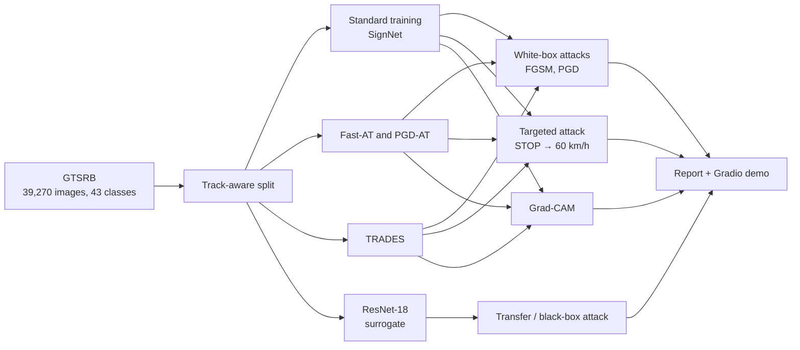

### Threat model
- **Norm:** L∞ in pixel space, inputs in [0, 1]
- **Budget:** ε = 8/255 for the headline numbers; curves over ε ∈ {0, 1, 2, 4, 6, 8, 12, 16}/255
- **Knowledge:** White-box (the attacker knows the weights). A transfer attack covers the black-box setting.
- Normalization happens **inside** the model, so attacks are defined directly in pixel space and ε keeps its meaning.

### Architecture: SignNet
A ResNet-style CNN for 48×48 inputs, built from **pre-activation residual + Squeeze-and-Excitation** blocks with SiLU activations (~0.7M parameters), sized to train on a 4 GB laptop GPU. A **ResNet-18** adapted to small inputs serves as a baseline and as the surrogate for transfer attacks.

### Training
| Technique | Details |
|---|---|
| Track-aware validation split | GTSRB contains ~30 consecutive frames of each physical sign. A random split leaks data, so we split by track |
| On-GPU augmentation | Rotation, scale, translation, shear, brightness and contrast. **No horizontal flips on purpose**: a flipped "turn left" sign becomes "turn right" |
| Efficient pipeline | Whole dataset cached on the GPU, mixed precision (AMP), SGD + Nesterov + OneCycle, EMA weights |
| ε warmup | Prevents early collapse in adversarial training |
| Model selection on robust accuracy | Counters robust overfitting |
| **Fast-AT** | Single-step FGSM with random start; catastrophic overfitting is caught by PGD-based model selection |
| **PGD-AT** | Training on multi-step PGD adversarial examples (3 steps to fit a laptop GPU) |
| **TRADES** | Trades clean accuracy against robustness via β |

### Gradient-masking checks
To detect false robustness, `evaluate.py` checks for every model that PGD is stronger than FGSM, that accuracy decreases as ε grows, and that accuracy drops to ~0 at a very large ε (64/255).

## Dataset

| | |
|---|---|
| 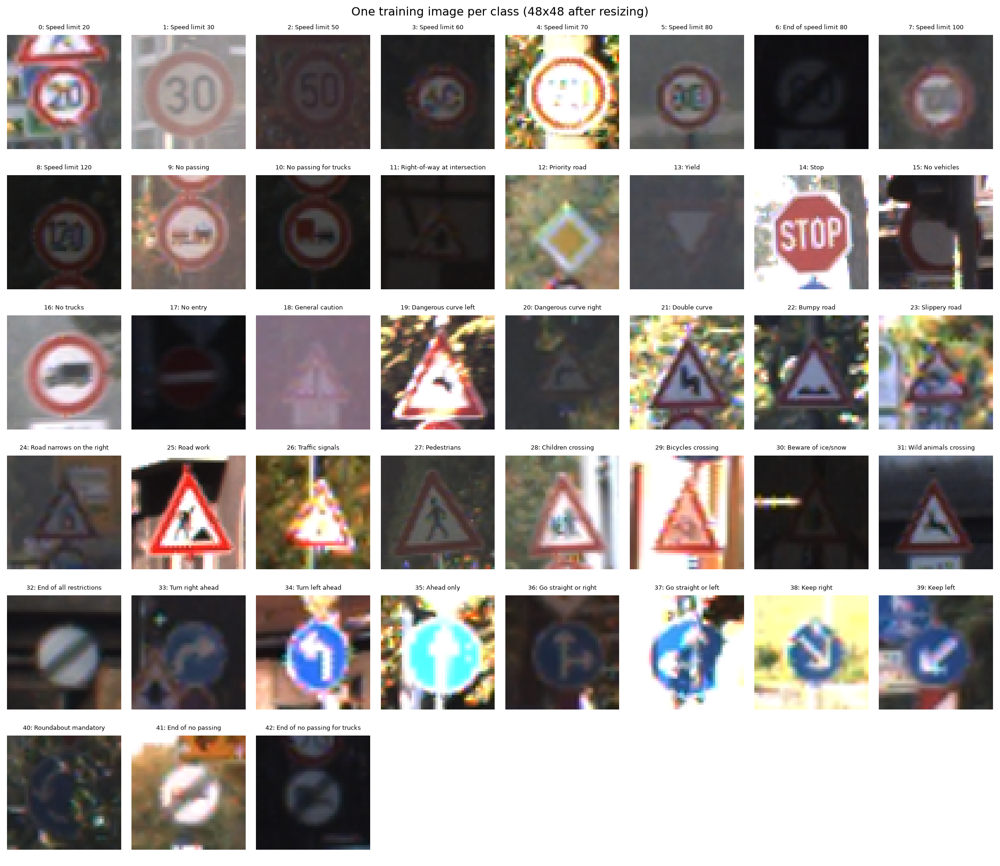 | 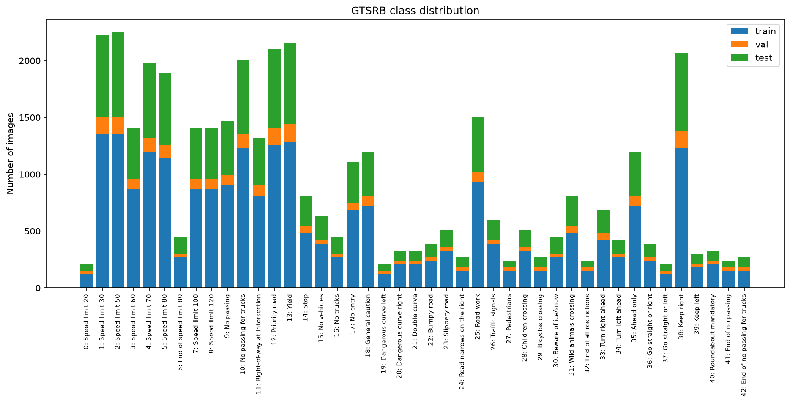 |
| 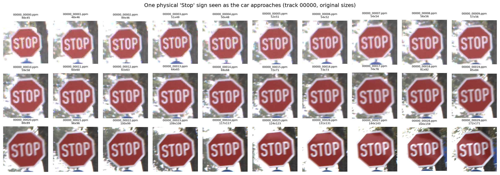 | 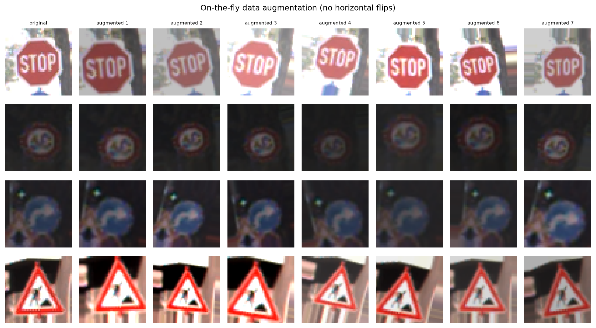 |

## Results

White-box L∞ attacks on a random subset of 3,000 GTSRB test images.

| Model | Clean accuracy | FGSM ε=8/255 | PGD-20 ε=8/255 |
|---|---|---|---|
| standard | 99.30% | 34.40% | 6.90% |
| fast_at | 95.03% | 72.10% | 59.63% |
| pgd_at | 94.97% | **72.83%** | **63.40%** |
| trades | 87.20% | 63.80% | 59.00% |
| resnet18_surrogate | 98.93% | 26.87% | 6.70% |

All five models pass the gradient-masking checks: PGD is always at least as strong as FGSM, accuracy decreases monotonically with ε, and PGD at ε = 64/255 drives every model to 0%.

**Targeted attack: STOP → Speed limit 60** (success rate on the 270 STOP signs in the test set, PGD-50)

| Model | ε=2/255 | ε=4/255 | ε=8/255 | ε=12/255 | ε=16/255 |
|---|---|---|---|---|---|
| standard | 8.9% | 22.6% | **86.3%** | 100.0% | 100.0% |
| fast_at | 1.1% | 10.7% | 13.0% | 27.4% | 41.1% |
| pgd_at | 0.0% | 0.4% | 13.0% | 20.0% | 38.5% |
| trades | 0.0% | 0.0% | **10.4%** | 19.6% | 38.9% |

**Transfer attack** (accuracy of the target model on PGD-20, ε=8/255 examples crafted on the source model, 2,000 test images; the diagonal is white-box)

| Source ↓ / Target → | resnet18 | standard | fast_at | pgd_at | trades |
|---|---|---|---|---|---|
| resnet18_surrogate | 6.4% | 47.8% | 88.2% | 89.3% | 77.9% |
| standard | 54.5% | 6.0% | 90.5% | 91.1% | 80.3% |
| fast_at | 56.9% | 57.9% | 60.1% | 67.6% | 65.3% |
| pgd_at | 59.2% | 61.8% | 66.1% | 64.0% | 64.8% |
| trades | 63.2% | 64.8% | 72.8% | 74.5% | 58.9% |

| | |
|---|---|
| 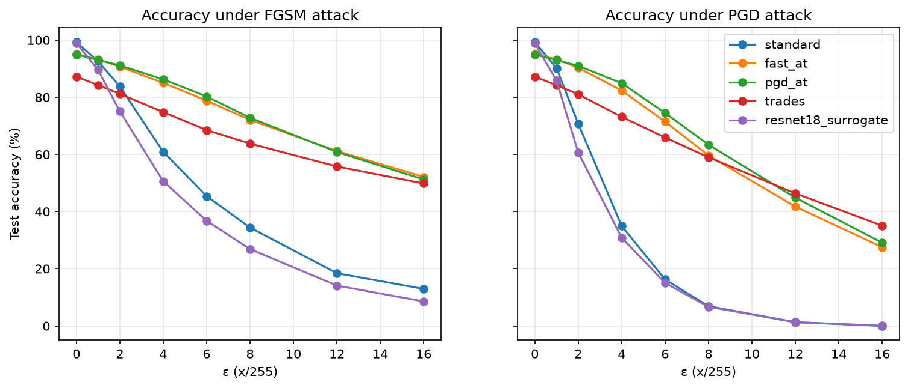 | 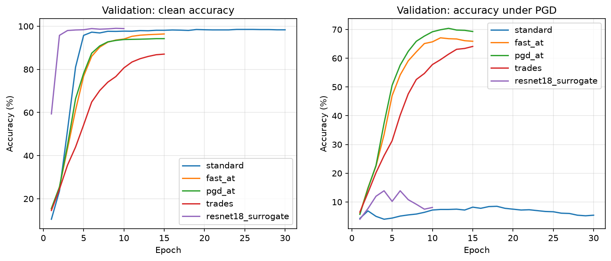 |
| 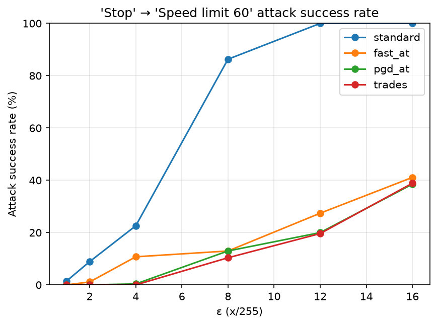 | 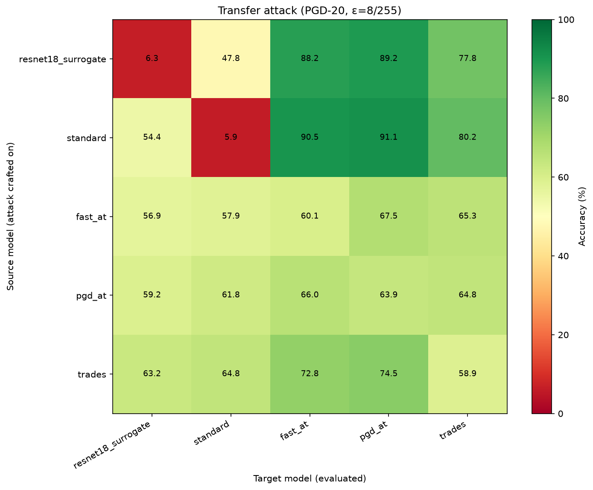 |

**Targeted attack examples (STOP → 60 km/h)**
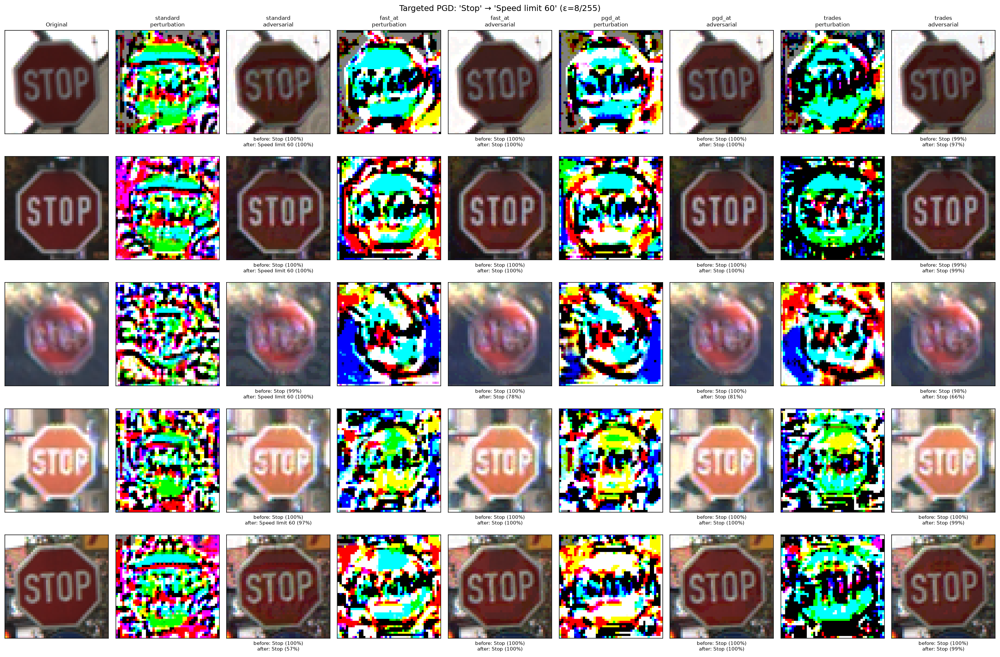

**Grad-CAM: how the attack shifts the model's attention**
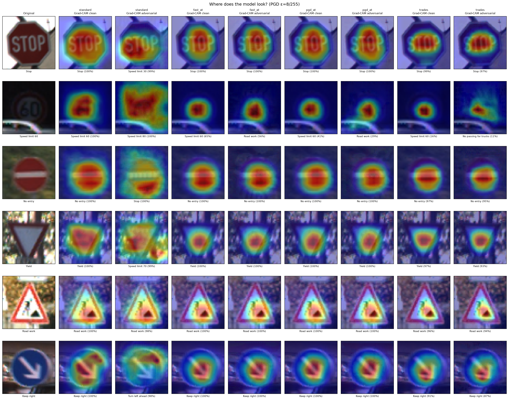

### Findings
- **High accuracy is not reliability.** The standard model reaches 99.30% clean accuracy but drops to 6.90% under PGD-20, with a perturbation of at most ~3% per pixel.
- **An attacker can choose the mistake.** With ε = 8/255, 86.3% of STOP signs are read as "Speed limit 60" by the standard model, and 100% at ε = 12/255. Adversarial training cuts this to 10-13%.
- **Single-step attacks overestimate robustness.** FGSM leaves the standard model at 34.40%, five times higher than PGD. Robustness must be measured with iterative attacks.
- **Adversarial training works.** PGD-AT raises robust accuracy from 6.90% to 63.40% (about 9x) at a cost of 4.3 points of clean accuracy.
- **Fast-AT is a strong budget option.** It reaches 59.63%, within 3.8 points of PGD-AT, at 67 s per epoch versus 80 s, with no sign of catastrophic overfitting.
- **TRADES trades clean accuracy for graceful degradation.** Under a 15-epoch budget it underfits (87.20% clean), yet it holds up best at large budgets (35.1% at ε = 16/255 versus 29.1% for PGD-AT) and has the lowest targeted success rate at ε = 8/255 (10.4%).
- **Black-box attacks are a real threat, but only for undefended models.** Examples crafted on a ResNet-18 the attacker owns cut the standard model from 99.30% to 47.8% without any access to it, while the adversarially trained models stay at 78-89%.
- **Capacity alone does not buy robustness.** ResNet-18 has 16x more parameters than SignNet but is just as fragile (6.70%).
- **Selection bias is visible.** PGD-AT scored 70.4% under PGD-10 on the validation set used for model selection, but 63.40% under the stronger PGD-20 on test data.

### Training cost (RTX 3050 Ti Laptop, 4 GB)
| Model | Epochs | Time per epoch | Total |
|---|---|---|---|
| standard | 30 | ~61 s | ~31 min |
| fast_at | 15 | ~67 s | ~17 min |
| pgd_at (3 steps) | 15 | ~80 s | ~20 min |
| trades (3 steps) | 15 | ~137 s | ~35 min |
| resnet18_surrogate | 10 | ~145 s | ~25 min |

## Installation

```powershell
git clone https://github.com/hakan-atalay/gtsrb-adversarial-robustness.git
cd gtsrb-adversarial-robustness
py -3.12 -m venv .venv
.venv\Scripts\activate
pip install torch torchvision --index-url https://download.pytorch.org/whl/cu126
pip install -r requirements.txt
```

## Usage

```powershell
python -m signguard.data
python -m signguard.explore
python -m signguard.train --mode standard --name standard --epochs 30
python -m signguard.train --mode fast --name fast_at --epochs 15
python -m signguard.train --mode pgd --name pgd_at --epochs 15 --steps 3 --alpha 3
python -m signguard.train --mode trades --name trades --epochs 15 --steps 3 --alpha 3
python -m signguard.train --mode standard --arch resnet18 --name resnet18_surrogate --epochs 10
python -m signguard.evaluate --models standard fast_at pgd_at trades resnet18_surrogate --n-samples 3000
python -m signguard.targeted --models standard fast_at pgd_at trades
python -m signguard.transfer --models resnet18_surrogate standard fast_at pgd_at trades
python -m signguard.gradcam --models standard fast_at pgd_at trades
python app.py --models standard pgd_at
```

Or run everything at once with `powershell -ExecutionPolicy Bypass -File scripts/run_all.ps1`.

The data is downloaded automatically from the official GTSRB server via `torchvision` (~350 MB). Run the tests with `pytest -q`.

## Project structure

```
gtsrb-adversarial-robustness/
├── signguard/
│   ├── config.py       Paths, constants, class names
│   ├── data.py         Download, track-aware split, GPU cache and augmentation
│   ├── explore.py      Dataset overview figures
│   ├── models.py       SignNet and ResNet-18
│   ├── attacks.py      FGSM, PGD (targeted/untargeted), TRADES loss
│   ├── train.py        Standard, Fast-AT, PGD-AT and TRADES training
│   ├── evaluate.py     Robustness curves, summary table, gradient-masking checks
│   ├── targeted.py     STOP → 60 km/h targeted attack experiment
│   ├── transfer.py     Black-box transfer attack matrix
│   ├── gradcam.py      Grad-CAM visualization
│   ├── metrics.py      Accuracy and attack success metrics
│   ├── visualize.py    Plots
│   └── utils.py        Checkpoints, EMA, seeding, shared CLI arguments
├── app.py              Gradio demo (Turkish interface)
├── tests/              Unit tests and an end-to-end pipeline test
├── scripts/run_all.ps1 Runs the whole pipeline
├── results/            JSON results and summary table
└── figures/            Generated figures
```

## Limitations and future work
- Attacks are digital. Physical-world robustness (stickers, lighting, viewing angle) needs separate study.
- Threat models other than L∞ (L2, patch attacks) are out of scope.
- TRADES would likely benefit from a longer training budget.
